<div align="center">



<a href="https://git.io/typing-svg">
  
</a>

<p>
  <a href="https://normanlinn.github.io/portfolio"></a>
  <a href="https://github.com/normanlinn"></a>
  
</p>

</div>

---

###  About me

```ts
const norman = {
  name:       "Zaw Lin Naing",
  location:   "Los Angeles, CA 🌴",
  role:       "Frontend Developer",
  focus:      ["React", "Next.js", "TypeScript", "Motion design"],
  learning:   ["Design systems", "Accessibility", "Backend with Node & Go"],
  background: ["C#", ".NET", "Web development"],
  funFact:    "I use tabs over spaces 😛",
  askMeAbout: "anything web, animation, or C#/.NET",
};
```

<br />

### ⚡ Tech stack

<div align="center">

**Frontend**


**Backend & data**


**Tools & cloud**


</div>

<br />

### 🚀 Featured projects

<table>
  <tr>
    <td width="50%" valign="top">
      <h4><a href="https://github.com/normanlinn/portfolio">✦ portfolio</a></h4>
      Editorial developer portfolio with Framer Motion animations.<br /><br />
      
      
    </td>
    <td width="50%" valign="top">
      <h4><a href="https://github.com/normanlinn/calculus-study-site">∫ calculus-study-site</a></h4>
      Interactive study guide for Stewart Calculus 2.8 and 3.1–3.5.<br /><br />
      
      
    </td>
  </tr>
  <tr>
    <td width="50%" valign="top">
      <h4><a href="https://github.com/normanlinn/LAXCommute">✈ LAXCommute</a></h4>
      Getting around LA, one commute at a time.<br /><br />
      
    </td>
    <td width="50%" valign="top">
      <h4><a href="https://github.com/normanlinn/burman-boba">🧋 burman-boba</a></h4>
      A boba shop site with a Burmese twist.<br /><br />
      
    </td>
  </tr>
</table>

<br />

### 📊 GitHub stats

<div align="center">

<a href="https://github.com/normanlinn">
  
  
</a>


</div>

<br />


