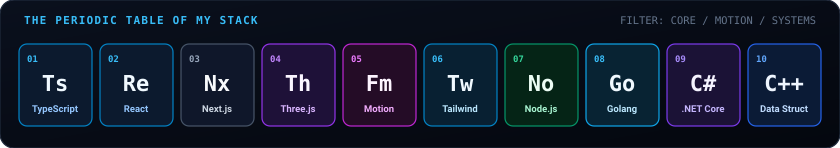

<!-- Hero Header (Bespoke 840px Edge-to-Edge) -->

  
  
  
  

---

### ✦ Selected Work &amp; Interactive Creations

  

  <strong>🛫 LAXCommute</strong> &nbsp;[ <a href="https://employeeshuttlelax.com/">Live App ↗</a> · <a href="https://github.com/normanlinn/LAXCommute">Source Code</a> ] &nbsp;&nbsp;✦&nbsp;&nbsp;
  <strong>🏮 Yay Kyaw Nights</strong> &nbsp;[ <a href="https://yaykyawfair.vercel.app/">Play Game ↗</a> · <a href="https://github.com/normanlinn/yaykyawfair">Source Code</a> ]
   
  <strong>📐 Derivatives Guide</strong> &nbsp;[ <a href="https://normanlinn.github.io/calculus-study-site/">Study Guide ↗</a> · <a href="https://github.com/normanlinn/calculus-study-site">Source Code</a> ] &nbsp;&nbsp;✦&nbsp;&nbsp;
  <strong>🍵 Burman Tea</strong> &nbsp;[ <a href="https://burmantea.vercel.app/">Visit Site ↗</a> ]

  <a href="https://normanlinn.github.io/"><strong>✦ Explore the 3D airport portfolio ↗</strong></a> &nbsp;·&nbsp; <a href="https://normanlinn.github.io/quick/"><strong>Quick view ↗</strong></a>

---

### ✦ The Periodic Table of My Stack

  

---

### ✦ GitHub Activity &amp; Momentum

 

<!-- Animated Wave Footer -->

  

