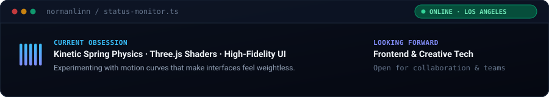

<!-- Hero Banner -->

<!-- Dynamic Animated Typing Bar -->

  

<!-- Sleek Glass Navigation & Badges -->

  
  
  
  

---

### ✦ Status Monitor

  

---

### 🚀 Selected Work & Interactive Creations

<table border="0" style="border: none; background: transparent;">
  <tr style="border: none; background: transparent;">
    <td style="border: none; padding: 6px;" width="50%" align="center">
      
    </td>
    <td style="border: none; padding: 6px;" width="50%" align="center">
      
    </td>
  </tr>
  <tr style="border: none; background: transparent;">
    <td style="border: none; padding: 6px;" width="50%" align="center">
      
    </td>
    <td style="border: none; padding: 6px;" width="50%" align="center">
      
    </td>
  </tr>
</table>

  <a href="https://normanlinn.github.io/portfolio/"><strong>✦ View Full Motion Portfolio &amp; Interaction Lab ↗</strong></a>

---

### 🛠 The Tech Stack

  

---

### 📈 GitHub Momentum

  

 

<!-- Animated Wave Footer -->

